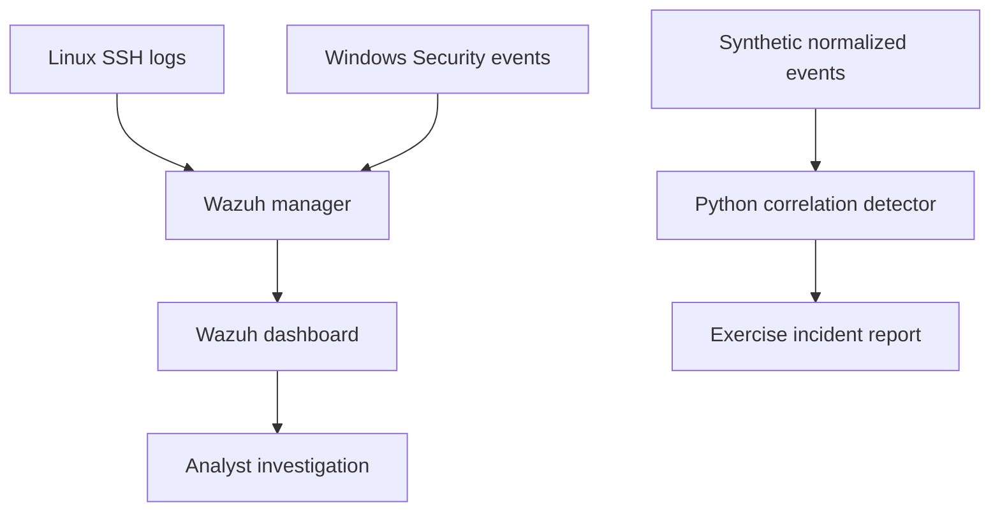

# Security Monitoring & Incident Detection Lab

## Run the working demonstration
```sh
python cybersecurity/detect.py
```
Eight normalized synthetic authentication events produce two alerts: repeated failures and a subsequent success. Review `reports/alerts.json` and `reports/incident-report.md`. The Python detector is independent of Wazuh and is not a SIEM emulator.

## Architecture

The Wazuh path is the deployment plan. The Python path is the locally implemented demo.

## Live lab setup to complete on your computer
1. Install VirtualBox from the official vendor. Create an isolated lab network and take VM snapshots. Allocate resources according to [Wazuh's current quickstart](https://documentation.wazuh.com/current/quickstart.html); the manager needs substantially more memory than this Python demo.
2. Create a Linux manager VM, an Ubuntu endpoint, and optionally a licensed/evaluation Windows endpoint. Use NAT only for needed downloads, and avoid bridged exposure of lab services.
3. Install the Wazuh manager/dashboard using the official guide. From the dashboard's Deploy new agent workflow, install agents on the endpoints and verify they are active.
4. On Linux verify that SSH authentication logs are being collected (the distribution may use `/var/log/auth.log`, `/var/log/secure`, or journald). On Windows enable failed-logon auditing and confirm the Security channel produces event 4625.
5. Back up the manager's existing local rules. Merge the sample rule from `wazuh/local_rules.xml`; do not replace unrelated rules. Rule ID 100101 must be unique.
6. Run `/var/ossec/bin/wazuh-logtest` with an invalid-user SSH log and confirm the installed ruleset matches rule 5710. Test repeated samples and inspect the custom correlation result. The sample targets invalid-user SSH only, not all authentication failures. Installed versions can differ; validate the threshold rather than assuming Python and Wazuh correlation are identical.
7. Restart the manager after validating configuration. From your own lab endpoint, manually attempt several logins to a deliberately nonexistent lab user. Do not test against third-party systems. Capture the actual events and alert details.
8. Investigate and write your own report, including false positives, evidence, and proposed response. Validate Windows rules separately; the delivered SSH rule does not cover Windows events.

## Evidence checklist
Capture agent connectivity, source log entries, Wazuh alert with rule ID/time, topology, and one investigated alert. Remove secrets, usernames of real people, public IPs, and credentials before committing evidence. Keep the synthetic report clearly distinguished from your live lab report.

## Event schema
Required JSONL fields: timezone-aware ISO `timestamp`, `host`, `source_ip`, `user`, and `result` (`failure` or `success`). Events are sorted before correlation. Failures exactly 300 seconds old remain in the default window. No raw Windows/XML or Linux syslog parser is included. Malformed input fails explicitly instead of silently being skipped.
